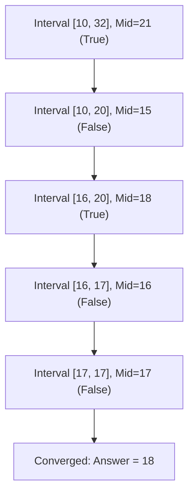

# Binary Search on Answer — Visual Flow & State Transitions

## 1. Decision Function Monotonic Step

```text
Target: Find minimum X where condition check(X) is true.

Values:     10   12   14   16   17   18   19   20   25   32
check(X):   [F]  [F]  [F]  [F]  [F]  [T]  [T]  [T]  [T]  [T]
                                      ^
                           Target Optimal Value = 18
```

## 2. Iterative Bisection Tree


