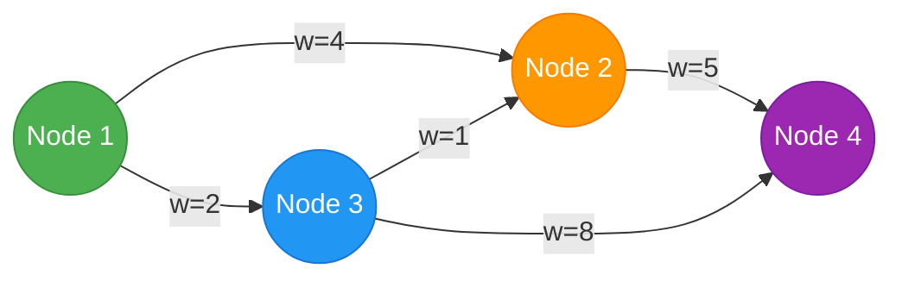

# Dijkstra's Algorithm — Visual Graph Relaxation

## 1. Graph Topology & Edge Weights



---

## 2. Settled Wavefront Expansion

```text
Time 0: Settled = { 1 (dist=0) }
        Frontier: (Node 3, dist 2), (Node 2, dist 4)

Time 2: Node 3 settled! (dist=2)
        Edge 3 -> 2 relaxes Node 2 from 4 down to 3!
        Settled = { 1, 3 }
        Frontier: (Node 2, dist 3), (Node 4, dist 10)

Time 3: Node 2 settled! (dist=3)
        Edge 2 -> 4 relaxes Node 4 from 10 down to 8!
        Settled = { 1, 3, 2 }
        Frontier: (Node 4, dist 8)

Time 8: Node 4 settled! (dist=8)
        All reachable vertices finalized!
```
