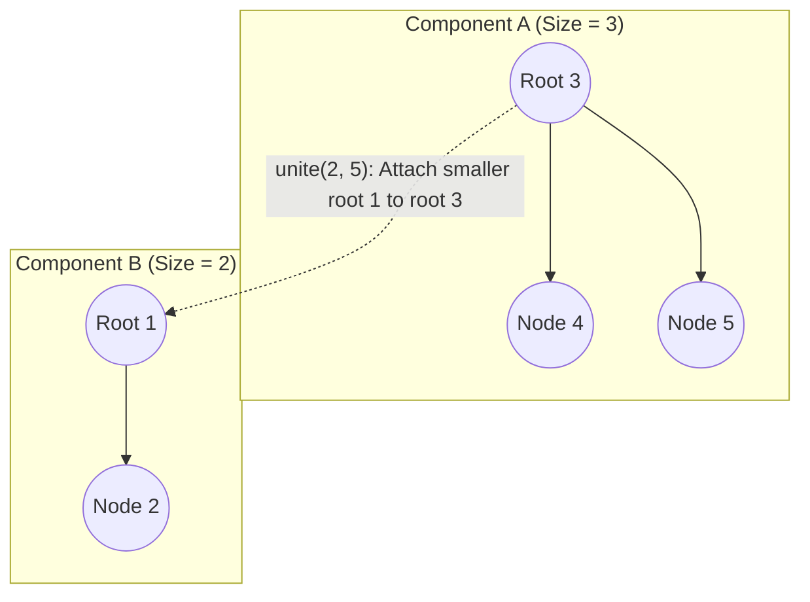

# Disjoint Set Union — Visual Transitions & Path Compression

## 1. Union by Size (Attaching Smaller to Larger)



---

## 2. Path Compression Visualized

```text
Before Calling find(4):
          Root (1)
             ^
             |
          Node (2)
             ^
             |
          Node (3)
             ^
             |
          Node (4)

After Calling find(4):
          Root (1)
        /    |    \
      Node2 Node3 Node4   <-- Tree depth flattened to 1!
```
