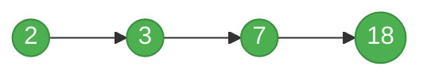

# Longest Increasing Subsequence — Visual Patience Piles

## 1. Patience Sorting State Progression

```text
Cards dealt: 10, 9, 2, 5, 3, 7, 101, 18

Step 1: [10]
Step 2: [ 9]
Step 3: [ 2]
Step 4: [ 2]  [ 5]
Step 5: [ 2]  [ 3]
Step 6: [ 2]  [ 3]  [ 7]
Step 7: [ 2]  [ 3]  [ 7]  [101]
Step 8: [ 2]  [ 3]  [ 7]  [ 18]
        ---   ---   ---   ----
Pile:    1     2     3     4

Total Number of Piles = 4 = Length of LIS
```

---

## 2. Dynamic Reconstruction Tree


