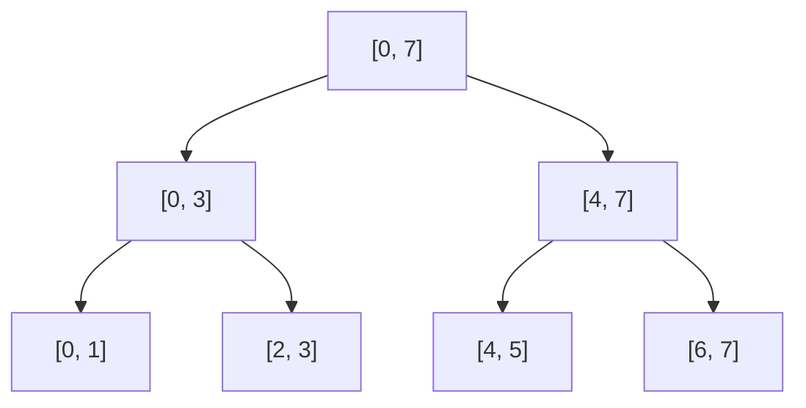

# Segment Tree — Visual Topology & Recursive Coverage

## 1. Segment Tree Hierarchy Over 8 Elements



---

## 2. Range Query Decomposition for `[2, 6]`

```text
Intervals visited:
- Root [0, 7]: Overlaps
  - Child [0, 3]: Overlaps
    - Leaf [0, 1]: DISJOINT (Ignored)
    - Node [2, 3]: FULLY CONTAINED (Collected in O(1))
  - Child [4, 7]: Overlaps
    - Node [4, 5]: FULLY CONTAINED (Collected in O(1))
    - Child [6, 7]: Overlaps
      - Leaf [6]: FULLY CONTAINED (Collected in O(1))
      - Leaf [7]: DISJOINT (Ignored)

Answer = Node[2, 3] + Node[4, 5] + Leaf[6]. (Only 3 nodes aggregated!)
```
