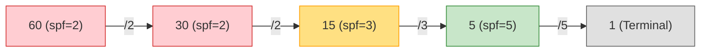

# Sieve of Eratosthenes — Visual Breakdown

## 1. Classical Sieve Redundant Marks vs. Linear Sieve Single Mark

```text
Evaluating Composite Number 12:

Classical Sieve:
- Prime 2 crosses off: 4, 6, 8, 10, [12], 14, 16, 18, 20...
- Prime 3 crosses off: 9, [12], 15, 18, 21...
Notice 12 is crossed off TWICE!

Linear Sieve (Euler's Sieve):
- When i = 6:
  p = 2 is tested.
  spf[2 * 6 = 12] = 2.
  Check: 6 % 2 == 0 -> IMMEDIATE BREAK.
  Prime 3 is NEVER allowed to touch 6!
Result: 12 is touched EXACTLY ONCE.
```

---

## 2. Factorization Descent Chain via SPF


