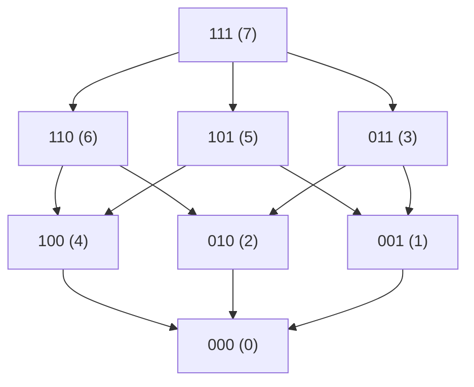

# Bit Manipulation — Visual Set Operations

## 1. Boolean Set Operations via Bitwise Registers

```text
Universal set U: {0, 1, 2, 3, 4, 5, 6, 7}
Bit index:       7 6 5 4 3 2 1 0

Set A = {1, 3, 4}   -> Binary: 0 0 0 1 1 0 1 0 (Value = 26)
Set B = {3, 4, 6}   -> Binary: 0 1 0 1 1 0 0 0 (Value = 88)

Operations:
Intersection (A ∩ B): A & B -> 0 0 0 1 1 0 0 0 ({3, 4})
Union        (A ∪ B): A | B -> 0 1 0 1 1 0 1 0 ({1, 3, 4, 6})
Symmetric Diff (A △ B): A ^ B -> 0 1 0 0 0 0 1 0 ({1, 6})
Complement (U \ A)  : ~A    -> 1 1 1 0 0 1 0 1 ({0, 2, 5, 6, 7})
```

---

## 2. Submask Lattice Graph for 3-bit Masks


