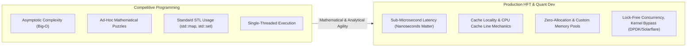

# Quantitative Development & Low-Latency Engineering Specialisation

A dedicated portal bridging Competitive Programming algorithmic excellence with Quantitative Developer (Quant Dev) and High-Frequency Trading (HFT) engineering principles.

---

## 1. Competitive Programming vs. Real-World HFT Systems

It is vital to distinguish between algorithmic problem-solving and production high-frequency trading:

### The Intersection
- **What CP gives you**: Rapid algorithmic intuition, deep fluency in graph theory, dynamic programming, combinatorics, bitwise operations, fast tree manipulation, and mental discipline.
- **What CP does NOT teach**: Real-world OS scheduling, memory bus saturation, L1/L2 cache miss latency penalty, branch predictor warm-up, POSIX shared memory, lock-free ring buffers, socket bypass, and exchange protocol encoding (FIX/SBE/ITCH).

---

## 2. Core Mathematical Pillars for Quant Preparation

### A. Discrete Probability & Linearity of Expectation
- Sum of random variables: $\mathbb{E}[X + Y] = \mathbb{E}[X] + \mathbb{E}[Y]$ regardless of independence.
- Indicator random variables for counting occurrences.
- Conditional probability and Bayes' Theorem.
- Gambler's Ruin and simple 1D random walks.
- Absorbing Markov chains and fundamental matrix computation.

### B. Combinatorics & Generating Functions
- Stars and Bars for discrete distribution states.
- Derangements and inclusion-exclusion bounds.
- Catalan numbers and valid path formulations.

### C. Game Theory & Expected Value Betting
- Impartial games and Sprague-Grundy theorem.
- Kelly Criterion for optimal capital allocation.
- Optimal stopping problems (e.g. Secretary Problem, house edge models).

---

## 3. Systems & Performance Engineering Foundations

### A. Memory Hierarchy and Cache Locality
- An $L1$ cache hit takes $\approx 1$ ns ($\sim 4$ CPU cycles).
- Main memory (RAM) access takes $\approx 50 - 100$ ns ($\sim 200 - 400$ cycles).
- A theoretical $O(1)$ lookup in `std::unordered_map` or $O(\log N)$ in pointer-chasing `std::set` (Red-Black Tree) frequently underperforms a linear scan ($O(N)$) over a contiguous `std::vector` for small $N$ due to CPU prefetching and cache-line saturation.

### B. Data Layout: Array of Structures (AoS) vs. Structure of Arrays (SoA)
- **AoS**: Storing `{price, volume, timestamp}` structs contiguously wastes cache lines when an algorithm only queries `price`.
- **SoA**: Storing `vector<price>`, `vector<volume>`, `vector<timestamp>` enables SIMD vectorization and maximizes cache bandwidth.

### C. Low-Latency Data Structures
- **Circular Ring Buffer**: Power-of-two capacity ring buffer using bitwise mask `index & (CAPACITY - 1)`.
- **Order Book Matching Engine**: Level-2 and Level-3 order books implemented using contiguous price ladder arrays, double-ended queues, or flat map indexed by tick sizes.
- **Fast Order Statistic Tracking**: Fenwick trees over discrete price ticks for $O(\log P)$ cumulative volume queries.

---

## 4. Curated Reading List & Authoritative Resources

### Foundational Textbooks
1. **"A Practical Guide To Quantitative Finance Interviews"** by Xinfeng Zhou (Green Book) — Probability, brainteasers, calculus, and stochastic processes.
2. **"Fifty Challenging Problems in Probability with Solutions"** by Frederick Mosteller.
3. **"Computer Systems: A Programmer's Perspective (CS:APP)"** by Randal E. Bryant and David R. O'Hallaron — Hardware architecture, virtual memory, cache hierarchy.
4. **"C++ Templates: The Complete Guide"** by David Vandevoorde, Nicolai M. Josuttis, Douglas Gregor.

### Core Quant Dev Topics Directory
- `00-cpp-foundations`: Strict memory control, move semantics, constexpr evaluation.
- `14-bit-manipulation`: Bit-level hacks, POPCNT, fast bit-mask aggregations.
- `15-probability-and-statistics`: Expectation, random walks, Markov chains.
- `16-game-theory`: Minimax, optimal strategies.
- `21-contest-engineering`: Profiling, bench-marking, compiler optimizations.
