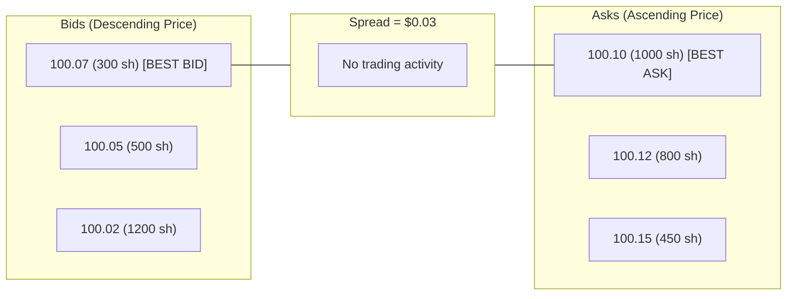

# Limit Order Book — Visual Cache Architecture

## 1. Flat Cache-Line Packed Price Ladder

```text
Memory Offset: 0x00       0x10       0x20       0x30       0x40 (Next Line)
             +----------+----------+----------+----------+
Cache Line 0 | Tick 0   | Tick 1   | Tick 2   | Tick 3   | ...
(64 Bytes)   | Vol: 100 | Vol: 250 | Vol: 0   | Vol: 500 |
             +----------+----------+----------+----------+
             |<------ Fetched into CPU L1 in single 1ns transaction ------>|
```

---

## 2. Order Matching Wavefront


