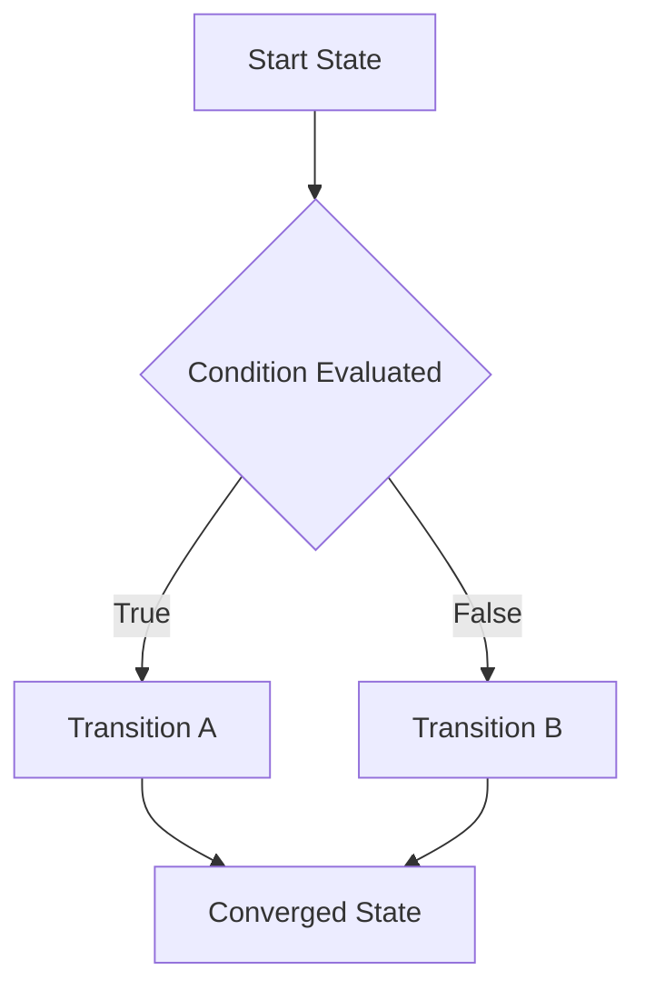

# [Topic Name] — Visual Explanation

## 1. High-Level Diagram



## 2. Memory & Pointer Transformations

```text
[Visual ASCII layout representing memory addresses, pointer movements, or array windows]
```
