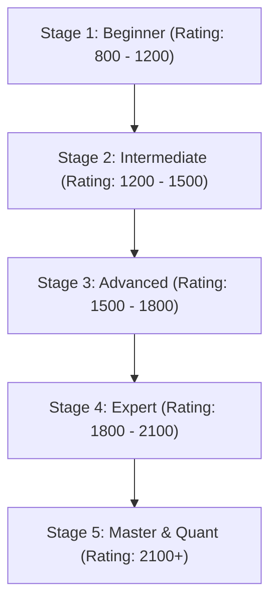

# Competitive Programming and Algorithmic Mastery Roadmap

A five-stage structured curriculum designed to build mathematical intuition, algorithmic speed, and robust C++20 engineering skills.

---

## Stage-by-Stage Curriculum Overview

---

## Stage 1: Foundations & Algorithmic Building Blocks (Target: CF 800 - 1200)

**Primary Objective**: Develop effortless translation of English problem statements into clean, bug-free C++20 code, with intuition for $O(N)$ and $O(N \log N)$ constraints.

- **00. C++ Foundations & STL**: Fast I/O, containers (`std::vector`, `std::set`, `std::map`, `std::priority_queue`), iterators, lambdas, custom comparators, structured bindings, integer overflow prevention (`long long`).
- **01. Complexity Analysis**: Asymptotic notation ($O, \Theta, \Omega$), operations per second ceiling ($\approx 10^8$ ops/sec in 1s), recurrence relations, memory limits.
- **02. Basic Problem-Solving**: Frequency arrays, coordinate compression, prefix and suffix sums, difference arrays, two pointers, sliding window, greedy heuristics, constructive patterns.
- **03. Searching Basics**: Monotonic predicates, binary search on values, standard library binary search (`std::lower_bound`, `std::upper_bound`).
- **05. Sorting Algorithms**: Merge sort, quick sort, counting sort, comparator design, stability.
- **06. Basic Data Structures**: Stacks, queues, circular queues, deques, monotonic stacks, monotonic queues.

---

## Stage 2: Intermediate Algorithms & Tree/Graph Foundations (Target: CF 1200 - 1500)

**Primary Objective**: Master recursive decompositions, tree/graph traversals, state modeling, and number-theoretic building blocks.

- **03. Searching & Optimization**: Binary search on answer, ternary search, meet-in-the-middle basics.
- **04. Recursion & Backtracking**: Recursion trees, state restoration, subset/permutation generation, pruning.
- **07. Tree Foundations**: DFS/BFS on trees, parent/depth tracking, subtree sizes, tree diameter, Euler tour.
- **08. Graph Foundations**: Adjacency lists, connected components, cycle detection, bipartite testing, topological sort, Dijkstra's algorithm, Disjoint Set Union (DSU) with union-by-rank and path compression.
- **09. Dynamic Programming Fundamentals**: Memoization vs. tabulation, state definitions, 1D/2D DP, 0/1 Knapsack, Unbounded Knapsack, Longest Increasing Subsequence (LIS), Longest Common Subsequence (LCS).
- **12. Number Theory Fundamentals**: Primality testing, Sieve of Eratosthenes, Euclidean GCD/LCM, modular arithmetic, modular exponentiation, Fermat's Little Theorem, modular inverse.

---

## Stage 3: Advanced Algorithms & Data Structures (Target: CF 1500 - 1800)

**Primary Objective**: Implement range query structures, solve multi-dimensional dynamic programming problems, and handle complex graph connectivity.

- **07. Advanced Trees**: Lowest Common Ancestor (Binary Lifting), Tree DP, Rerooting DP.
- **08. Graph Algorithms**: Bellman-Ford, Floyd-Warshall, 0-1 BFS, Kruskal's & Prim's MST, Bridges and Articulation points (Tarjan).
- **09. Multi-dimensional Dynamic Programming**: Grid DP, Interval DP, Tree DP, Bitmask DP basics.
- **10. Advanced Data Structures**: Fenwick Tree (Binary Indexed Tree), Segment Tree (point updates, range queries), Lazy Propagation, Sparse Table.
- **11. String Algorithms**: String hashing (polynomial rolling hash), KMP (prefix function), Z-algorithm.
- **13. Combinatorics**: Factorials, binomial coefficients with modular inverse, Pascal's triangle, Stars and Bars, Pigeonhole Principle.
- **14. Bit Manipulation**: Bitwise tricks, submask enumeration, binary tries.

---

## Stage 4: Expert Problem Solving & Decomposition (Target: CF 1800 - 2100)

**Primary Objective**: Deconstruct contest problems requiring combinations of data structures, network flows, tree decompositions, and game-theoretic models.

- **07 & 18. Tree & Graph Decompositions**: Heavy-Light Decomposition (HLD), Centroid Decomposition, Virtual Trees, Strongly Connected Components (Kosaraju / Tarjan), 2-SAT.
- **09. Advanced Dynamic Programming**: Digit DP, SOS DP (Sum Over Subsets), Divide and Conquer DP optimization, Convex Hull Trick (CHT), Knuth optimization.
- **10. Specialized Data Structures**: Persistent Segment Tree, Merge Sort Tree, Treaps, Sqrt Decomposition, Mo's Algorithm, DSU on Tree (Sack).
- **11. Advanced String Structures**: Aho-Corasick automaton, Suffix Automaton, Manacher's algorithm.
- **16. Game Theory**: Impartial games, Nim, Sprague-Grundy theorem, XOR games.
- **17. Computational Geometry**: Point/Vector algebra, orientation, line segment intersection, Convex Hull (Graham scan / Monotone chain), Sweep line.
- **18. Network Flow**: Ford-Fulkerson, Edmonds-Karp, Dinic's blocking flow algorithm, Min-cut theorem, Maximum Bipartite Matching.

---

## Stage 5: Master Level & Quantitative Systems (Target: CF 2100+ & Quant Prep)

**Primary Objective**: Achieve top-percentile problem-solving agility, rigorous mathematical proof generation, and deep knowledge of low-latency, cache-friendly data structures.

- **10 & 19. Master Data Structures**: Li Chao Tree, Link-Cut Tree, Randomized Data Structures, Parallel Binary Search.
- **15. Probability & Statistics**: Linearity of expectation, conditional expectation, random walks, Markov chains, probabilistic DP.
- **20. Advanced Mathematics**: Matrix exponentiation, Gaussian elimination over fields, Fast Fourier Transform (FFT) / Number Theoretic Transform (NTT), Lagrange interpolation.
- **21. Contest Engineering**: Differential stress testing, automated test generators, cache-locality optimization, memory layout engineering.
- **22. Quant & HFT Specialization**: Low-latency architecture concepts, cache-friendly algorithms, order-statistic mechanics, trade-off between asymptotic complexity and real hardware cycle latency.
